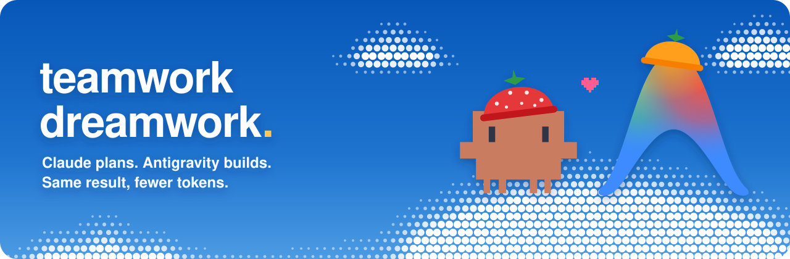

<p align="center">
  
</p>

<p align="center">
  <a href="LICENSE"></a>
  
  
  
</p>

<p align="center">
  <a href="#install"><b>Install</b></a> ·
  <a href="#how-it-works"><b>How it works</b></a> ·
  <a href="#usage"><b>Usage</b></a> ·
  <a href="#settings-environment-variables"><b>Settings</b></a>
</p>

# teamwork-dreamwork

A Claude Code skill for token-saving teamwork. Claude is the boss and Google Antigravity (the `agy` CLI) is the worker. Every task goes to the cheapest model and effort level that can do it: Claude inline, a Haiku sub-agent, Antigravity on Gemini Flash / Sonnet / Opus, or Claude + the built-in `/advisor` for hard work.

## How it works

### The team
- **Claude**: Boss — plans, routes, reviews, runs tests, never commits.
- **Antigravity worker**: Worker agent (`agy` CLI) that does handed-off tasks.
- **The advisor**: Stronger model Claude consults for hard calls (set with `/advisor`).
- **Haiku sub-agent**: Lightweight Claude sub-agent for cheap lookups.

### What each file does
Everything lives in one skill folder, `teamwork-dreamwork/`:

| File | Who uses it | What it does |
|---|---|---|
| `SKILL.md` | Claude | Routing rules, lane cost tiers, advisor triggers, and token guidelines. |
| `team-mode.md` | Claude | The base workflow: board conventions, task preamble, file locks, and review flow. |
| `agy/run.sh` | Claude | Runs worker tasks, handles model fallback and queued inbox (reads `AGY_MODEL`, `AGY_MODE`, `AGY_FROM`). Refuses to start while another task runs in the same project. |
| `agy/ask.sh` | Claude / user | Side Q&A session given task context without interrupting work (reads `AGY_FROM`, `AGY_ASK_MODEL`). |
| `agy/tell.sh` | Claude / user | Sends instructions to worker; queues them if a task is running, otherwise sends them right away as a follow-up on the last task (reads `AGY_FROM`). |
| `agy/chat.sh` | User | Terminal chat box for questions, instructions, and status (reads `AGY_FROM`). |
| `agy/context.py` | `ask.sh`, `chat.sh` | Extracts task progress and running status from `.agy/live.log`. |
| `agy/log.py` | agy scripts | Appends structured JSON events to `.agy/live.log` for the watcher. |
| `agy/py.sh` | agy scripts | Finds a working Python 3 (`python3`, `python`, then `py`; or `AGY_PYTHON`). |
| `watch.py` | User | Live log viewer (macOS, Linux, Windows) showing agent activity, tools, and stream output. |
| `watch.ps1` | User | The same viewer in PowerShell, for Windows users who prefer it. |

### Settings (environment variables)
| Variable | Used by | Default | What it sets |
|---|---|---|---|
| `AGY_MODEL` | `run.sh` | `claude-opus-5-5-high` | Worker model **and** effort (`-low` / `-medium` / `-high`). See `agy models`. |
| `AGY_ASK_MODEL` | `ask.sh` | `claude-opus-5-5-high` | Model for side questions. Claude uses `gemini-3.8-flash-low` for quick status checks. |
| `AGY_FALLBACK` | `run.sh`, `ask.sh` | `gemini-3.8-flash-high` | Model to switch to once when the chosen one is out of usage. |
| `AGY_MODE` | `run.sh` | `accept-edits` | `agy --mode`. Use `plan` for read-only tasks like reviews. |
| `AGY_FROM` | all scripts | `Claude` (run.sh) / `You` | Name shown in the watcher. |
| `AGY_PYTHON` | all scripts | first working of `python3`, `python`, `py` | Python 3 to use, e.g. a full path. |

If the chosen model is out of usage, `run.sh` and `ask.sh` switch to `AGY_FALLBACK` once.

**Any model works.** These variables take any id from `agy models`: Claude, Gemini, Argon, GPT-OSS, or whatever your account has. The routing table only picks defaults. Ask for a model by name ("use Argon for this", "run everything on GPT-OSS") and Claude uses it. Claude also checks `agy models` once per session and swaps a default for the closest model your account actually has.

`run.sh` exit codes: `0` done, `1` another task is already running, `69` `agy` produced no result (missing, not signed in, or crashed) or Python 3 wasn't found, `75` out of usage. On `69` or `75`, Claude uses the backup lane.

### What gets created in your project
- `.agy/`: Copied scripts and runtime state (`live.log`, `last-conversation`, `inbox`, `task.lock`).
- `TASKS.md`: The board tracking file locks, queues, and task status.
Both should be git-ignored.

### A typical run
1. Type `/teamwork-dreamwork` (or "save tokens") for multi-part work.
2. On first use in a project, Claude copies the scripts into `.agy/` and creates `TASKS.md`. It also lists Antigravity's own skills so it can tell the worker to use a matching one.
3. Claude plans tasks in `TASKS.md`, locks files, and routes each to the cheapest capable lane (consulting the advisor first for the plan and for hard or risky tasks).
4. Claude handles tiny edits inline, delegates lookups to Haiku, or hands tasks to Antigravity via `.agy/run.sh`, one at a time.
5. Antigravity runs in the background; you can watch live progress or send instructions via chat.
6. Claude reviews the worker's diff, runs tests, and fixes any issues. If the result fails review, the task moves up one lane (higher effort, then a stronger model).
7. Claude releases locks, updates `TASKS.md`, and leaves reviewed, uncommitted changes ready for you to commit.

### Watching and talking to the worker
- **Watcher** (any OS, run from your project folder): `python3 ~/.claude/skills/teamwork-dreamwork/watch.py` (add `--history` to replay). On Windows use `python` instead of `python3` if needed, or the PowerShell version: `powershell -File "$HOME\.claude\skills\teamwork-dreamwork\watch.ps1"` (add `-History`).
- **Chat box** (bash): `bash .agy/chat.sh`
  - *Plain text*: Question answered right away by a side session without interrupting the task.
  - `/tell <message>`: Instruction for the task session (queued while busy, delivered when current step ends).
  - `/status`: Shows whether a task is running and its recent actions.
  - `/quit`: Exits the chat box.

## Requirements

- **Claude Code**
- **Antigravity CLI (`agy`)**: on `PATH` and signed in
- **bash**: built in on macOS and Linux (macOS's bash 3.2 is fine); Git Bash on Windows
- **Python 3**: `python3` or `python` on `PATH` (standard library only)
- Works on **macOS, Linux and Windows**. PowerShell is optional (Windows-only watcher alternative).
- **Antigravity skills**: expected in the default `~/.gemini/config/skills`

## Install

Copy the `teamwork-dreamwork` skill folder into `~/.claude/skills/`.

macOS / Linux / Git Bash:
```bash
git clone https://github.com/Cchheanglim/teamwork-dreamwork.git
mkdir -p ~/.claude/skills
cp -r teamwork-dreamwork/teamwork-dreamwork ~/.claude/skills/
```

Windows PowerShell:
```powershell
git clone https://github.com/Cchheanglim/teamwork-dreamwork.git
New-Item -ItemType Directory -Force "$HOME\.claude\skills" | Out-Null
Copy-Item -Recurse -Force teamwork-dreamwork\teamwork-dreamwork "$HOME\.claude\skills\"
```

Restart Claude Code after copying so the skill shows up. To update later, `git pull` and run the copy command again.

## Recommended Setup

- Run `/model sonnet` and `/advisor opus` in Claude Code.
- Or set `"model": "sonnet"` and `"advisorModel": "opus"` in `~/.claude/settings.json`.

## Usage

Type `/teamwork-dreamwork` (or say "save tokens") for multi-part work; skip it for quick questions and one-line fixes.

### Routing Table

| Size | Examples | Who | How |
|---|---|---|---|
| **Tiny** | one-line fix, rename, config value, typo | Claude, inline | Claude does it directly. A hand-off costs more tokens than the edit. |
| **Lookup** | find where X is used, read many files and summarize | Claude sub-agent, Haiku | Agent tool with `model: "haiku"`, `effort: "low"`; returns conclusion only. |
| **Small, mechanical** | tests for existing code, boilerplate, docs, copy, simple page/component, lint fixes | Antigravity, Flash | `AGY_MODEL=gemini-3.8-flash-low` for copy/docs/renames, `gemini-3.8-flash-medium` for tests and components. |
| **Medium, self-contained** | a new module, a feature behind a clear interface, a multi-file page | Antigravity, Sonnet/Opus | `AGY_MODEL=claude-sonnet-5-5-medium` first; `claude-opus-5-5-high` when design-heavy or retrying. |
| **Hard or risky** | architecture, auth, security, data migrations, deleting things, a bug that survived 2 fix attempts | Claude + advisor | Claude consults the advisor before choosing the approach, then does it itself. |

**Backup lane:** if Antigravity is out of usage (including its Flash fallback) or `agy` isn't available (`run.sh` exit `75` or `69`), Small and Medium tasks go to a Claude Sonnet sub-agent at low or medium effort instead of the main session. Claude reviews its work the same way and switches back to Antigravity as soon as it works again.

## Safety Notes

- Never pass `--dangerously-skip-permissions`.
- Headless `agy` cannot run shell commands, so Claude runs all tests.
- Claude reviews every diff. A worker's "SUCCESS" is a claim, not proof.
- Only one Antigravity task runs at a time per project.
- Nothing is committed or pushed for you; reviewed changes are left in your working tree.

## License

MIT (see LICENSE).

Not affiliated with Anthropic or Google. Clawd and the Antigravity logo belong to their owners and appear in the banner as a fan nod to the two tools this project connects.
